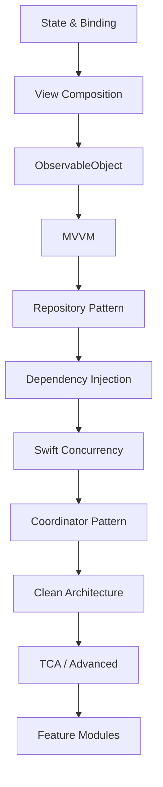

# iOS Microarchitecture Learning Roadmap

> A structured path from Swift/SwiftUI fundamentals to advanced architecture patterns.

## 🎯 Learning Philosophy

1. **Learn by building** - Each concept with a small project
2. **Understand the "why"** - Know when to use each pattern
3. **Build muscle memory** - Repeat patterns across projects
4. **Stay current** - iOS 17+ patterns preferred

---

## 📊 The 20+ Concepts Overview

| # | Concept | Domain | Difficulty |
|---|---------|--------|------------|
| 1 | [[State-and-Binding]] | State | ⭐ Beginner |
| 2 | [[View-Composition]] | UI | ⭐ Beginner |
| 3 | [[ViewModifier-Pattern]] | UI | ⭐ Beginner |
| 4 | [[ObservableObject]] | State | ⭐⭐ Intermediate |
| 5 | [[StateObject-vs-ObservedObject]] | State | ⭐⭐ Intermediate |
| 6 | [[MVVM]] | Architecture | ⭐⭐ Intermediate |
| 7 | [[Repository-Pattern]] | Data | ⭐⭐ Intermediate |
| 8 | [[DTO-Pattern]] | Data | ⭐⭐ Intermediate |
| 9 | [[Protocol-Oriented-Dependencies]] | DI | ⭐⭐ Intermediate |
| 10 | [[Constructor-Injection]] | DI | ⭐⭐ Intermediate |
| 11 | [[Swift-Concurrency]] | Async | ⭐⭐ Intermediate |
| 12 | [[Environment-Injection]] | DI | ⭐⭐ Intermediate |
| 13 | [[EnvironmentObject]] | State | ⭐⭐ Intermediate |
| 14 | [[Coordinator-Pattern]] | Navigation | ⭐⭐⭐ Advanced |
| 15 | [[Container-Presentational]] | UI | ⭐⭐⭐ Advanced |
| 16 | [[Network-Layer-Design]] | Data | ⭐⭐⭐ Advanced |
| 17 | [[MainActor]] | Async | ⭐⭐⭐ Advanced |
| 18 | [[Actors]] | Async | ⭐⭐⭐ Advanced |
| 19 | [[Combine-Framework]] | Reactive | ⭐⭐⭐ Advanced |
| 20 | [[Clean-Architecture]] | Architecture | ⭐⭐⭐⭐ Expert |
| 21 | [[TCA]] | Architecture | ⭐⭐⭐⭐ Expert |
| 22 | [[VIPER]] | Architecture | ⭐⭐⭐⭐ Expert |
| 23 | [[Redux-Pattern]] | Architecture | ⭐⭐⭐⭐ Expert |
| 24 | [[Feature-Modules]] | Modular | ⭐⭐⭐⭐ Expert |
| 25 | [[SwiftData-Architecture]] | Data | ⭐⭐⭐ Advanced |
| 26 | [[MVC]] | Architecture | ⭐ Beginner |

---

## 🗺️ Learning Path

### Phase 1: SwiftUI Foundations (Weeks 1-2)
Build a simple Todo app.

```
Week 1:
├── Day 1-2: [[State-and-Binding]]
│   └── Build: Counter app, Toggle switches
├── Day 3-4: [[View-Composition]]
│   └── Build: Reusable card components
└── Day 5-7: [[ViewModifier-Pattern]]
    └── Build: Custom button styles, theming

Week 2:
├── Day 1-3: [[ObservableObject]] + [[StateObject-vs-ObservedObject]]
│   └── Build: Todo list with ViewModel
└── Day 4-7: [[MVVM]]
    └── Build: Complete Todo app with MVVM
```

### Phase 2: Data Layer Fundamentals (Weeks 3-4)
Build a Product Catalog app.

```
Week 3:
├── Day 1-3: [[Repository-Pattern]]
│   └── Build: Product repository (mock data)
├── Day 4-5: [[DTO-Pattern]]
│   └── Build: API response mapping
└── Day 6-7: [[Network-Layer-Design]]
    └── Build: API client for products

Week 4:
├── Day 1-4: [[Swift-Concurrency]]
│   └── Build: Async data loading
├── Day 5-6: [[SwiftData-Architecture]]
│   └── Build: Offline product cache
└── Day 7: Integration
    └── Build: Full catalog with network + cache
```

### Phase 3: Dependency Injection (Weeks 5-6)
Refactor existing apps for testability.

```
Week 5:
├── Day 1-3: [[Protocol-Oriented-Dependencies]]
│   └── Refactor: Abstract repositories
├── Day 4-5: [[Constructor-Injection]]
│   └── Refactor: Inject dependencies
└── Day 6-7: [[Environment-Injection]] + [[EnvironmentObject]]
    └── Build: App-wide dependency container

Week 6:
├── Day 1-4: Write unit tests for ViewModels
├── Day 5-6: Write integration tests
└── Day 7: Test coverage review
```

### Phase 4: Advanced UI Patterns (Weeks 7-8)
Build a multi-screen Shopping app.

```
Week 7:
├── Day 1-3: [[Coordinator-Pattern]]
│   └── Build: Navigation coordinator
├── Day 4-5: [[Container-Presentational]]
│   └── Build: Separated list views
└── Day 6-7: Deep linking implementation

Week 8:
├── Day 1-4: [[Combine-Framework]]
│   └── Build: Search with debounce
├── Day 5-6: [[MainActor]] + [[Actors]]
│   └── Build: Thread-safe cart manager
└── Day 7: Performance optimization
```

### Phase 5: Architecture Patterns (Weeks 9-12)
Rebuild app with different architectures.

```
Week 9-10: [[Clean-Architecture]]
├── Understand layers
├── Implement use cases
├── Add repository implementations
└── Build: Clean Shopping app

Week 11: [[TCA]]
├── Learn reducer pattern
├── Implement effects
├── Build: Feature with TCA
└── Compare with MVVM

Week 12: [[Feature-Modules]]
├── Extract features into modules
├── Setup Swift Package structure
├── Build: Modular app architecture
└── CI/CD considerations
```

---

## 🏗️ Practice Projects

### Beginner Projects
1. **Counter App** - State, Binding
2. **Todo List** - MVVM, ObservableObject
3. **Weather App** - Networking, DTOs

### Intermediate Projects
4. **Notes App** - SwiftData, Repository
5. **Recipe App** - Navigation, Coordinator
6. **Podcast Player** - Combine, async sequences

### Advanced Projects
7. **E-Commerce App** - Clean Architecture, Modules
8. **Social Feed** - TCA, pagination
9. **Banking App** - Security, Actors

---

## 📚 Recommended Order



---

## ✅ Self-Assessment Checklist

### Beginner
- [ ] Create views with `@State` and `@Binding`
- [ ] Build reusable view components
- [ ] Use `@StateObject` correctly

### Intermediate
- [ ] Implement MVVM pattern
- [ ] Create repository with protocol
- [ ] Use `async/await` for networking
- [ ] Inject dependencies via constructor

### Advanced
- [ ] Implement Coordinator for navigation
- [ ] Use Actors for thread safety
- [ ] Build Clean Architecture layers
- [ ] Create feature modules

### Expert
- [ ] Implement TCA or Redux pattern
- [ ] Modularize app with SPM
- [ ] Optimize build times
- [ ] Mentor others on architecture

---

## 🏷️ Tags
#roadmap #learning #ios #architecture #progression
