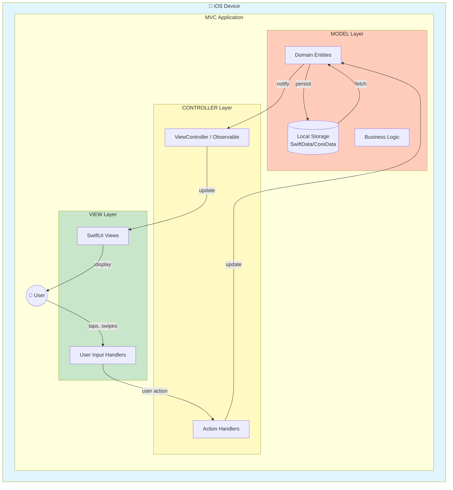
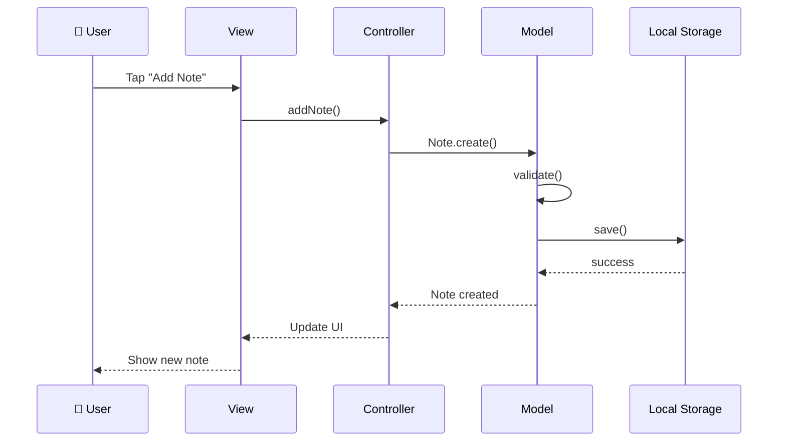
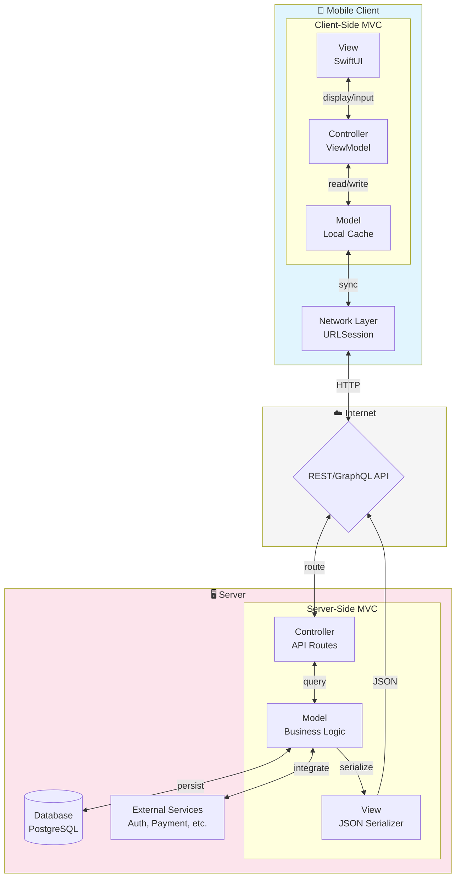
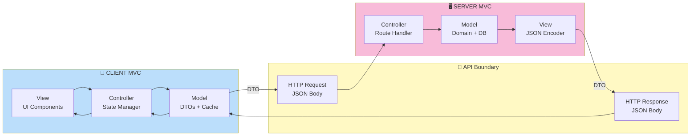
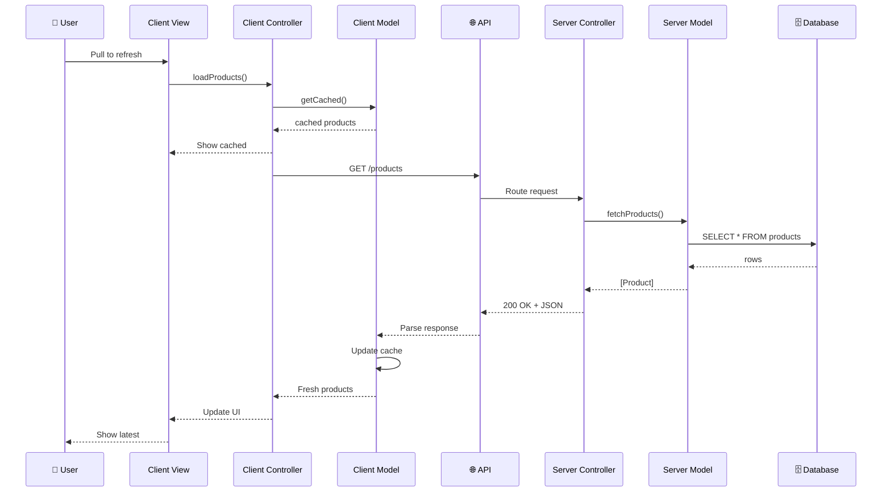
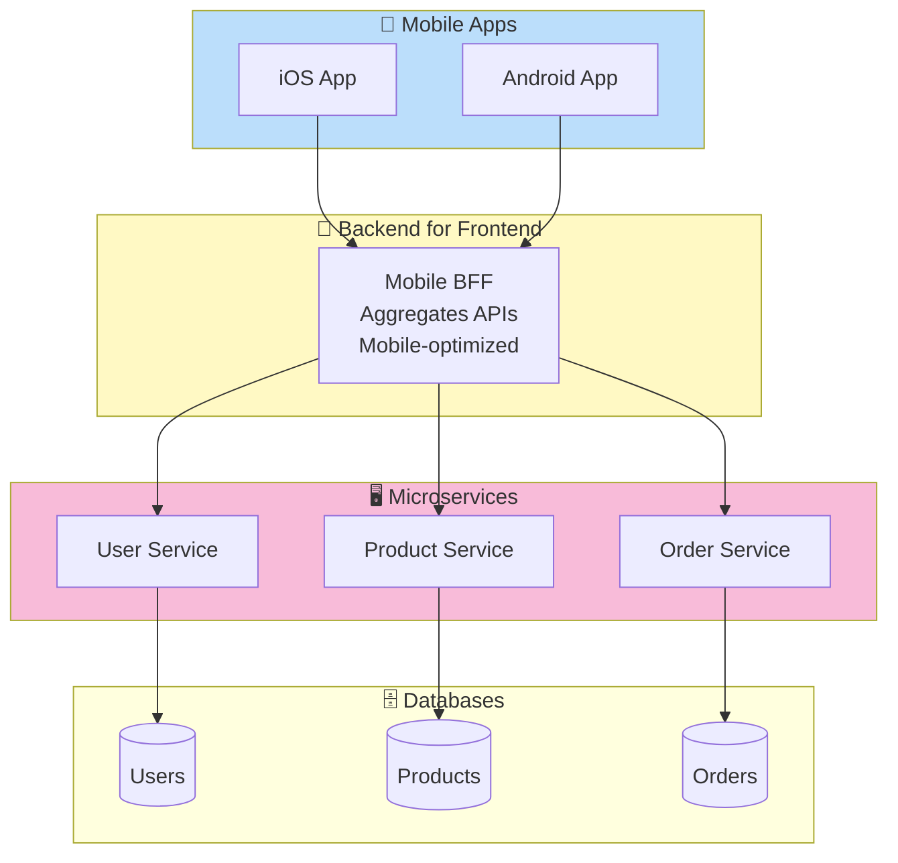
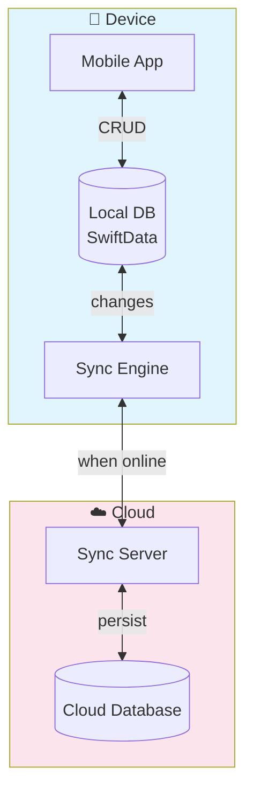

# MVC Across Application Architectures

> Understanding how Model-View-Controller applies to standalone apps, client-server systems, and web applications.

## Core Definitions

### What is a Client?

A **client** is the part of a system that:
- Runs on the user's device (phone, browser, desktop)
- Presents the user interface
- Initiates requests for data or actions
- Processes responses for display

```
┌─────────────────────────────────────┐
│              CLIENT                 │
│  "The part the user interacts with" │
├─────────────────────────────────────┤
│  • Mobile App (iOS/Android)         │
│  • Web Browser (Chrome, Safari)     │
│  • Desktop App (macOS, Windows)     │
│  • CLI Tool                         │
└─────────────────────────────────────┘
```

### What is a Server?

A **server** is the part of a system that:
- Runs on remote infrastructure (data center, cloud)
- Waits for and responds to client requests
- Manages shared data and business logic
- Handles authentication, storage, and integrations

```
┌─────────────────────────────────────┐
│              SERVER                 │
│   "The part that serves requests"   │
├─────────────────────────────────────┤
│  • API Server (REST, GraphQL)       │
│  • Database Server (PostgreSQL)     │
│  • Authentication Server (OAuth)    │
│  • File Storage (S3, CloudKit)      │
└─────────────────────────────────────┘
```

### What is MVC?

**Model-View-Controller** is a pattern that separates an application into three concerns:

| Component | Responsibility | Knows About |
|-----------|----------------|-------------|
| **Model** | Data & business logic | Nothing else |
| **View** | Display & user input | Model (to display) |
| **Controller** | Coordination & flow | Model & View |

---

## Architecture 1: Mobile App Only (Standalone)

A self-contained app where all components run on the device.

### Examples
- Calculator app
- Offline note-taking app
- Single-player game
- Local photo editor

### Characteristics
- No network required
- Data stored locally (UserDefaults, CoreData, SwiftData)
- All business logic on device
- Full functionality offline

### Diagram



### Code Structure (iOS)

```
MVC_Standalone/
├── Models/
│   ├── Note.swift           # Data entity
│   └── NoteValidator.swift  # Business rules
├── Views/
│   ├── NoteListView.swift   # UI display
│   └── NoteEditorView.swift # User input
├── Controllers/
│   └── NoteController.swift # Coordination
└── Storage/
    └── LocalNoteStorage.swift # Persistence
```

### Data Flow



---

## Architecture 2: Mobile App Client + Server

The app runs on the device but relies on remote servers for data and processing.

### Examples
- Social media app (Instagram, Twitter)
- Banking app
- E-commerce app
- Streaming app (Netflix, Spotify)

### Characteristics
- Requires network connectivity
- Shared data across users/devices
- Server handles heavy computation
- Client focuses on UI and caching

### Diagram



### The "Two MVCs" Concept

In client-server architecture, MVC exists at **both** ends:



### Client-Side MVC (iOS App)

| Component | Role in Client |
|-----------|----------------|
| **Model** | DTOs, cached entities, local validation |
| **View** | SwiftUI views, user interaction |
| **Controller** | API calls, state management, navigation |

### Server-Side MVC (Backend)

| Component | Role in Server |
|-----------|----------------|
| **Model** | Domain entities, business rules, DB access |
| **View** | JSON/XML serialization, response formatting |
| **Controller** | Route handling, request parsing, auth checks |

### Data Flow



---

## Architecture 3: Web App Client + Server

A web application where the browser is the client.

### Examples
- Gmail, Google Docs
- Facebook, Twitter (web)
- Figma, Notion
- Admin dashboards

### Characteristics
- Client runs in browser (JavaScript/TypeScript)
- Initial HTML may come from server
- API calls for dynamic data
- Can be SSR (Server-Side Rendered) or SPA (Single-Page App)

### Single-Page Application (SPA)

```mermaid
flowchart TB
    subgraph Browser["🌐 Browser Client"]
        subgraph SPA["JavaScript SPA (React/Vue/Angular)"]
            WView[View<br/>Components/JSX]
            WController[Controller<br/>State/Hooks]
            WModel[Model<br/>API Client + Store]
        end
        DOM[DOM Rendering]
    end
    
    subgraph CDN["📦 CDN"]
        Static[Static Assets<br/>HTML/JS/CSS]
    end
    
    subgraph API["🖥️ API Server"]
        Routes[REST/GraphQL]
        BLogic[Business Logic]
        Database[(Database)]
    end
    
    Browser -->|initial load| CDN
    CDN -->|bundle.js| Browser
    WView <--> WController
    WController <--> WModel
    WModel <-->|fetch()| Routes
    Routes <--> BLogic
    BLogic <--> Database
    WView --> DOM

    style Browser fill:#e8f5e9
    style CDN fill:#fff3e0
    style API fill:#fce4ec
```

### Server-Side Rendering (SSR)

Traditional web apps where the server generates HTML:

```mermaid
flowchart TB
    subgraph Browser["🌐 Browser"]
        HTML[Rendered HTML]
        JS[JavaScript<br/>for interactivity]
    end
    
    subgraph Server["🖥️ Web Server (Rails, Django, Laravel)"]
        subgraph MVC["Server MVC"]
            SView[View<br/>HTML Templates<br/>ERB/Jinja/Blade]
            SController[Controller<br/>Route Handlers]
            SModel[Model<br/>ORM + Logic]
        end
        DB[(Database)]
    end
    
    Browser -->|GET /products| SController
    SController -->|query| SModel
    SModel -->|SQL| DB
    DB -->|data| SModel
    SModel -->|@products| SView
    SView -->|render| SController
    SController -->|HTML| Browser
    Browser --> HTML
    HTML --> JS

    style Browser fill:#e8f5e9
    style Server fill:#fce4ec
```

### Comparison: SPA vs SSR

| Aspect | SPA (React/Vue) | SSR (Rails/Django) |
|--------|-----------------|-------------------|
| Initial Load | JS bundle + API calls | Full HTML from server |
| Navigation | Client-side routing | Full page reload |
| SEO | Challenging | Native support |
| MVC Location | Both client & server | Primarily server |
| Offline | Possible with PWA | Limited |

---

## Architecture 4: Hybrid Approaches

### 4a: Mobile + BFF (Backend for Frontend)

A dedicated backend tailored for mobile clients:



### 4b: Offline-First with Sync

Apps that work offline and sync when connected:



---

## Architecture 5: Full Stack Comparison

```mermaid
flowchart TB
    subgraph Standalone["1️⃣ Standalone Mobile"]
        S_MVC[Complete MVC<br/>on Device]
        S_DB[(Local Storage)]
        S_MVC <--> S_DB
    end
    
    subgraph ClientServer["2️⃣ Client-Server"]
        CS_Client[Client MVC<br/>UI + Cache]
        CS_API{API}
        CS_Server[Server MVC<br/>Logic + Data]
        CS_DB[(Database)]
        CS_Client <--> CS_API
        CS_API <--> CS_Server
        CS_Server <--> CS_DB
    end
    
    subgraph Web["3️⃣ Web SPA"]
        W_Browser[Browser MVC<br/>React/Vue]
        W_API{REST API}
        W_Server[Server Logic]
        W_DB[(Database)]
        W_Browser <--> W_API
        W_API <--> W_Server
        W_Server <--> W_DB
    end
    
    subgraph SSR["4️⃣ Web SSR"]
        SSR_Browser[Browser<br/>HTML + JS]
        SSR_Server[Server MVC<br/>Rails/Django]
        SSR_DB[(Database)]
        SSR_Browser <-->|HTML| SSR_Server
        SSR_Server <--> SSR_DB
    end

    style Standalone fill:#e1f5fe
    style ClientServer fill:#e8f5e9
    style Web fill:#fff3e0
    style SSR fill:#fce4ec
```



---

## MVC Component Mapping by Architecture

| Architecture | Model | View | Controller |
|--------------|-------|------|------------|
| **Standalone iOS** | Swift structs, SwiftData | SwiftUI Views | @Observable classes |
| **iOS + Server** | DTOs + Cache (client), Entities + DB (server) | SwiftUI (client), JSON (server) | ViewModel (client), Routes (server) |
| **Web SPA** | Store/State + API (client), Domain + DB (server) | React/Vue Components | Hooks/Actions (client), Express routes (server) |
| **Web SSR** | ORM Models | HTML Templates | Route Handlers |

---

## Key Takeaways

1. **MVC is a logical pattern**, not tied to any specific technology
2. **Client-server architectures have MVC on both ends**
3. **The "boundary" between client and server is typically JSON over HTTP**
4. **Choose architecture based on**:
   - Offline requirements
   - Data sharing needs
   - Team structure
   - Scalability requirements

---

## Related Concepts

- [[MVC]] - Basic pattern explanation
- [[Clean-Architecture]] - Layered approach
- [[Repository-Pattern]] - Data abstraction
- [[Network-Layer-Design]] - API client design
- [[DTO-Pattern]] - Client-server data transfer

## Tags
#architecture #mvc #client-server #web #mobile #diagrams
