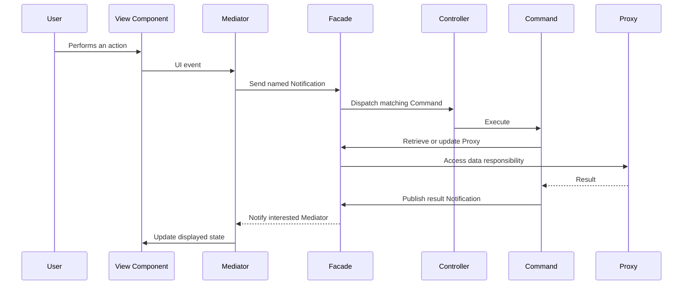

# PureMVC - Model-View-Controller Framework

> A lightweight MVC framework that coordinates application actors through a Facade and publish/subscribe Notifications.

## Overview

PureMVC implements the classic Model-View-Controller meta-pattern, with explicit actors for data, UI mediation, and application behavior. It is a framework, not just a set of naming conventions: the Facade creates and exposes the Model, View, and Controller, while their registries manage Proxies, Mediators, and Commands.

PureMVC Notifications decouple actors that do not share a direct reference. They follow publish/subscribe semantics, not UI event bubbling. In the Swift Multicore implementation, a notification has a string name and optional `Any?` body and `String?` type.

## Actors

| Actor | Responsibility |
|---|---|
| **[Facade](../glossary/Facade.md)** | Application-facing entry point. Coordinates access to Model, View, and Controller, exposes registration and lookup, and sends Notifications. |
| **[Model](../glossary/Model.md)** | Registry for Proxies. Proxies represent and manage application data and services. |
| **[Proxy](../glossary/Proxy.md)** | Encapsulates a data source or domain-facing data responsibility; can retrieve or update data and publish Notifications. |
| **[View](../glossary/View.md)** | Registry for Mediators and notification observers. |
| **[Mediator](../glossary/Mediator.md)** | Connects a view component to the framework: handles that component's UI events, supplies or updates its data, and responds to relevant Notifications. |
| **[Controller](../glossary/Controller.md)** | Registry that maps Notification names to Commands. |
| **[Command](../glossary/Command.md)** | Executes application behavior in response to a mapped Notification. It can coordinate Proxies and publish further Notifications. |
| **[Notification](../glossary/Notification.md)** | Named message distributed to registered observers; the Swift implementation supports an optional payload and type. |

The Facade is the normal collaboration boundary; application actors generally do not need to reach into the Model, View, or Controller implementation classes directly.

## Typical Interaction

Not every interaction must traverse every actor. For example, a Mediator can respond directly to a Notification, and a Proxy can publish a data-change Notification. UI events remain the view framework's responsibility; Notifications communicate application-level changes between PureMVC actors.

## Multicore

PureMVC has Standard and Multicore variants. Standard uses a Singleton core; Multicore uses a Multiton, allowing multiple independent cores in one process. Each core has its own Facade, Model, View, Controller, and actor registries. A core key identifies the subsystem, so independently developed modules can avoid collisions in registrations and notifications.

The Swift Multicore implementation requires actors to have a valid `multitonKey` before they can reach their Facade or send Notifications. The key is assigned by the framework when, for example, a Command executes or a Mediator is registered. This makes registration and lifecycle part of the module boundary, not incidental setup.

## Swift Framework Features

- The official Swift Multicore wiki describes support for iOS, watchOS, tvOS, and macOS.
- The framework provides interfaces and base implementations for Facade, Model, View, Controller, Proxy, Mediator, Commands, Notifications, and observers.
- The Swift Notification API uses a string name with optional `Any?` body and `String?` type. The payload is flexible but not statically typed at the framework boundary.
- Companion utilities listed by the project include Async Command, Async Proxy, Pipes, and State Machine. These extend the core framework; they are separate utilities rather than built-in MVC actors.
- The wiki lists an Employee Admin UIKit demo and identifies the Swift Multicore framework as production software. Check the linked project for current release and maintenance status before adopting it.

## Glossary

See [[Glossary]] for the complete linked concept index.

### Architecture and Messaging

- [[MVC-Meta-Pattern]] - The separation of application responsibilities that PureMVC specializes.
- [[Observer-Pattern]] and [[Publish-Subscribe]] - The notification observation and communication models.
- [[Event-Bubbling]] - A UI event propagation mechanism contrasted with PureMVC Notifications.
- [[View-Component]] - A UI object that a Mediator adapts to the framework.

### Core Lifecycle and Modularization

- [[Singleton]] and [[Multiton]] - The contrasting core-instance management patterns.
- [[Multicore-Architecture]] and [[Multiton-Key]] - Independent PureMVC cores and their identity/lifecycle key.

### Companion Utilities

- [[Async-Command]] - Asynchronous command execution.
- [[Async-Proxy]] - Asynchronous data operations behind a Proxy.
- [[Pipes]] - Message routing between actors or modules.
- [[State-Machine]] - Explicit application state and transition coordination.

## Strengths and Tradeoffs

| Strengths | Tradeoffs |
|---|---|
| Explicit roles and registration points make responsibilities discoverable. | More framework concepts and ceremony than a small SwiftUI feature usually needs. |
| Notification-based collaboration reduces direct dependencies between modules. | String notification names and `Any?` payloads can hide contracts and move errors to runtime. |
| Multicore isolates registries for modular applications and independently developed subsystems. | Core-key lifecycle and registration order must be understood and tested. |
| The same conceptual architecture is available across multiple platforms and languages. | The framework does not replace SwiftUI's view state, navigation, or concurrency design; integration boundaries still need to be designed. |

## When to Consider It

PureMVC is most relevant when an application needs explicit MVC actors, notification-driven collaboration, or isolated subsystems that share an architecture across teams or platforms. For a small SwiftUI app, native state and simpler dependency injection may be clearer. If using PureMVC with SwiftUI, keep view state and UI events in the view layer and use Mediators as adapters rather than treating Notifications as a substitute for `@State`, bindings, or Swift concurrency.

## Related Patterns

- [[MVC]] - The underlying architectural meta-pattern.
- [[MVC-Across-Architectures]] - MVC in client-server and web contexts.
- [[MVVM]] - A commonly used alternative for SwiftUI applications.
- [[Clean-Architecture]] - A layered approach that can be combined with an MVC-style presentation layer.

## Sources

- [PureMVC](https://puremvc.org/)
- [PureMVC Swift Multicore Framework Wiki](https://github.com/PureMVC/puremvc-swift-multicore-framework/wiki)
- [PureMVC Swift Multicore API Documentation](https://puremvc.org/pages/docs/Swift/multicore/)
- [PureMVC Swift Multicore Framework Repository](https://github.com/PureMVC/puremvc-swift-multicore-framework)

## Tags

#architecture #mvc #puremvc #modularization #swift