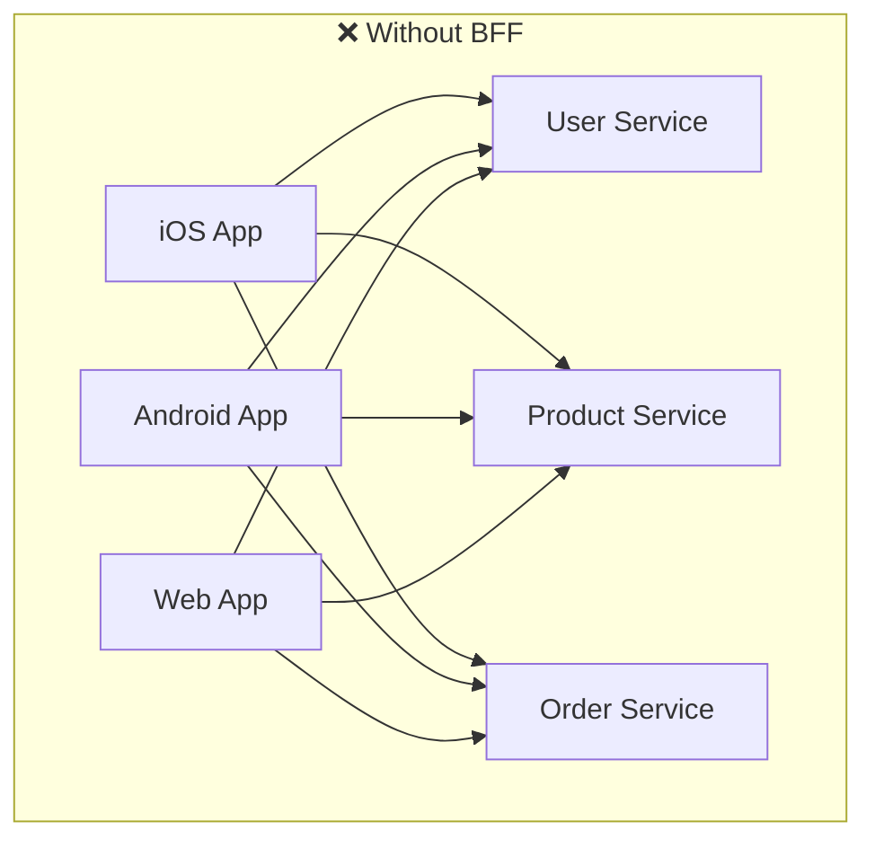
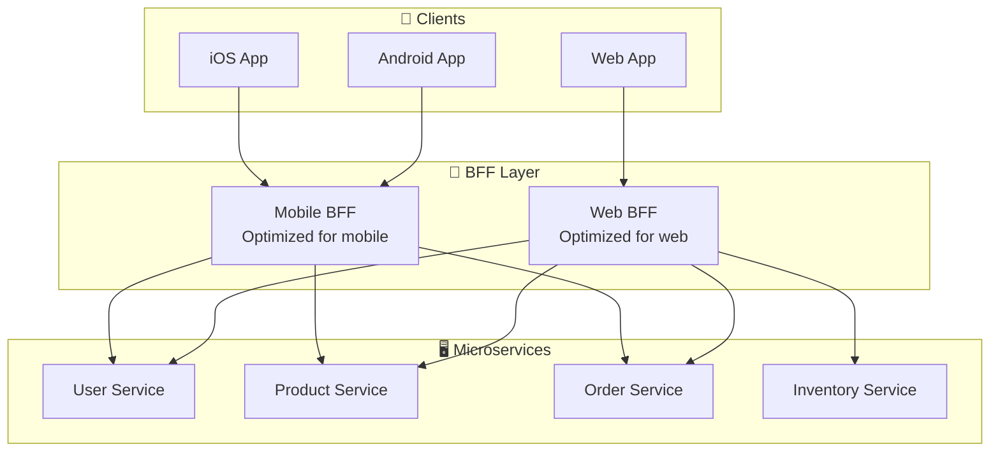
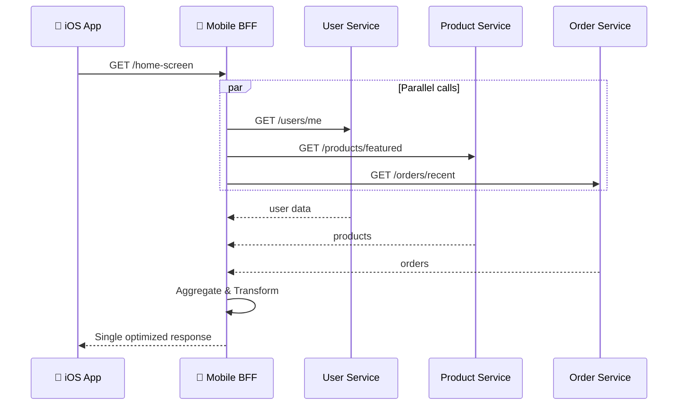
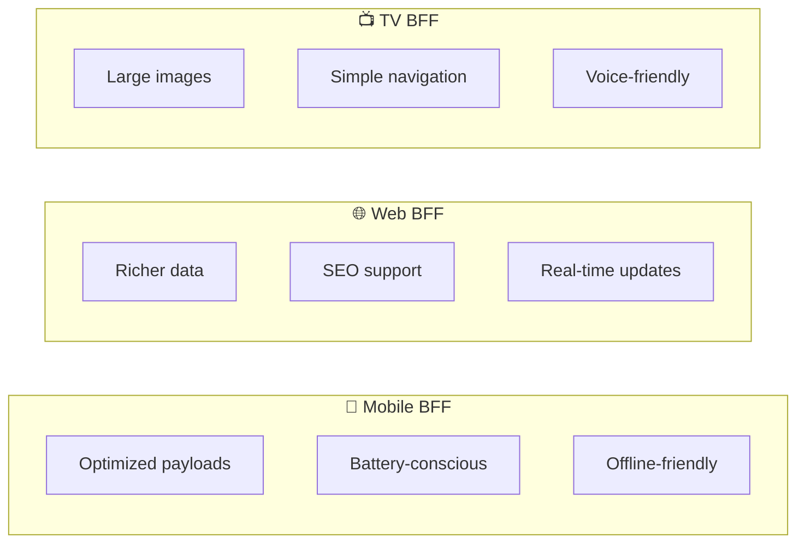

# BFF - Backend for Frontend

> A dedicated backend service tailored to a specific frontend client's needs.

## Definition

**Backend for Frontend (BFF)** is a pattern where:
- Each frontend (iOS, Android, Web) gets a **dedicated backend**
- The BFF **aggregates** calls to multiple microservices
- Responses are **optimized** for that specific client
- Reduces complexity in frontend code

## The Problem BFF Solves

Without BFF, each client must:
- Make multiple API calls
- Handle data aggregation
- Deal with over-fetching or under-fetching
- Adapt generic APIs to specific needs



**Problem:** Each client makes 3+ calls, handles aggregation, manages different data needs.

## BFF Architecture



## How BFF Works



## Example: Home Screen API

### Without BFF (Client aggregates)
```swift
// iOS Client - Multiple calls
func loadHomeScreen() async throws -> HomeData {
    async let user = api.get("/users/me")
    async let featured = api.get("/products/featured")
    async let orders = api.get("/orders/recent?limit=3")
    async let notifications = api.get("/notifications/unread")
    
    return HomeData(
        user: try await user,
        featured: try await featured,
        orders: try await orders,
        notifications: try await notifications
    )
}
```

### With BFF (Single call)
```swift
// iOS Client - Single call
func loadHomeScreen() async throws -> HomeData {
    return try await api.get("/mobile/home")
}
```

### BFF Implementation
```javascript
// Mobile BFF (Node.js)
app.get('/mobile/home', async (req, res) => {
  const userId = req.user.id;
  
  // Parallel calls to microservices
  const [user, products, orders, notifications] = await Promise.all([
    userService.getUser(userId),
    productService.getFeatured({ limit: 6 }),  // Mobile: fewer products
    orderService.getRecent(userId, { limit: 3 }),
    notificationService.getUnread(userId, { limit: 5 })
  ]);
  
  // Mobile-optimized response
  res.json({
    user: {
      name: user.firstName,  // Mobile: just first name
      avatarUrl: user.avatar.thumbnail  // Mobile: thumbnail only
    },
    featured: products.map(p => ({
      id: p.id,
      name: p.name,
      price: p.price,
      imageUrl: p.images[0].mobile  // Mobile-sized images
    })),
    recentOrders: orders.map(o => ({
      id: o.id,
      status: o.status,
      total: o.total
    })),
    unreadCount: notifications.length
  });
});
```

## BFF per Platform



## Pros and Cons

| Pros | Cons |
|------|------|
| ✅ Optimized for each client | ❌ More services to maintain |
| ✅ Single API call per screen | ❌ Code duplication risk |
| ✅ Reduces client complexity | ❌ Additional latency hop |
| ✅ Team autonomy | ❌ Need to keep in sync |
| ✅ Easier to evolve clients | ❌ Deployment coordination |

## When to Use BFF

✅ **Use BFF when:**
- Multiple clients with different needs
- Microservices architecture
- Complex data aggregation needed
- Different teams own different clients

❌ **Skip BFF when:**
- Single client
- Simple API requirements
- Monolithic backend
- Small team

## Related Concepts
- [[Client-Server-Architecture]] - The underlying model
- [[Server]] - Where BFF runs
- [[Network-Layer-Design]] - Client comunicaiton
- [[Feature-Modules]] - Client-side organization

## Tags
#system-architecture #bff #microservices #api #mobile
