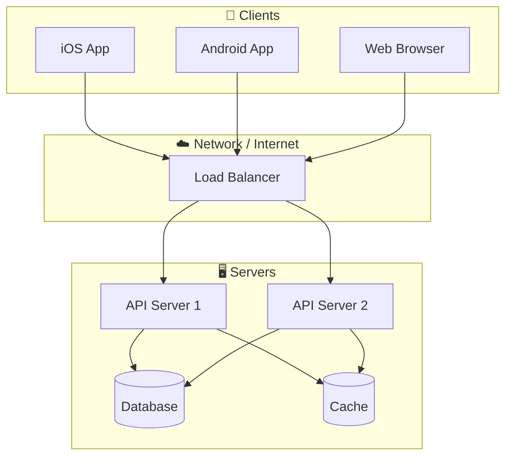
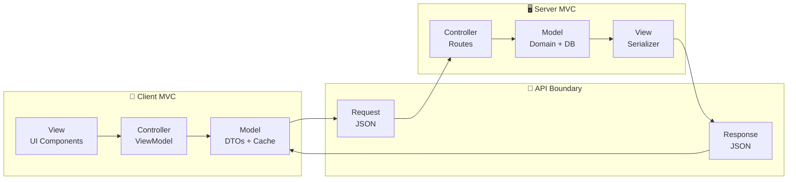
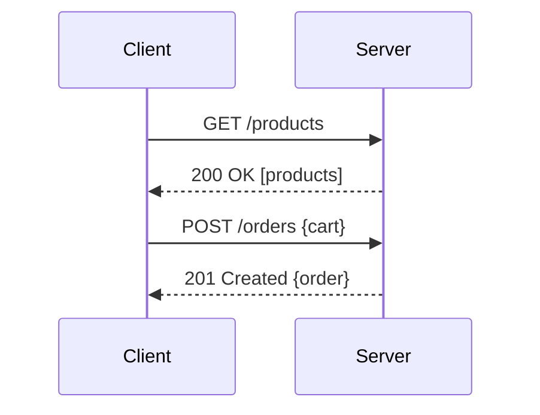
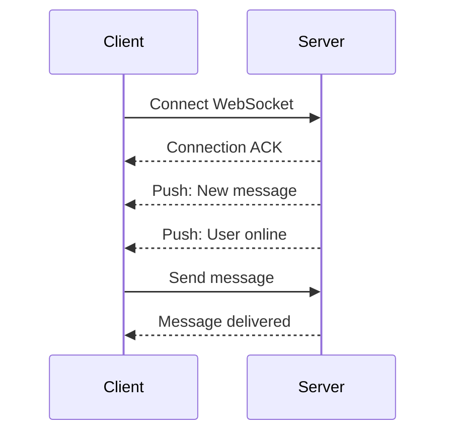
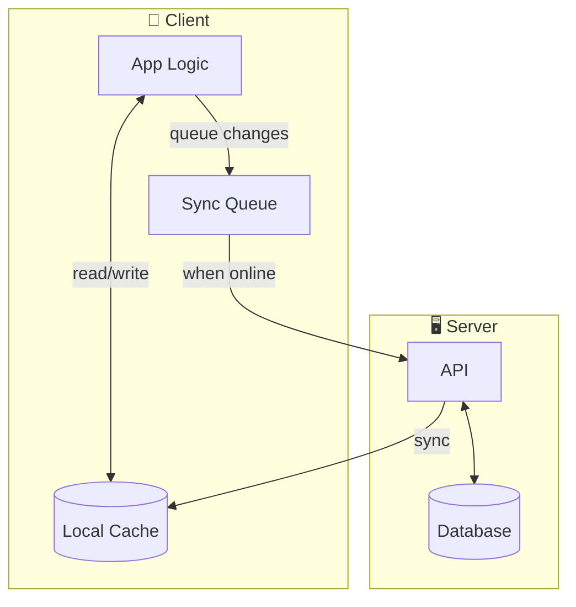

# Client-Server Architecture

> A distributed architecture where clients request services from centralized servers.

## Definition

**Client-Server Architecture** is a computing model where:
- **Clients** initiate requests for data or services
- **Servers** process requests and return responses
- Communication happens over a **network** (typically HTTP/HTTPS)
- Each side has **distinct responsibilities**

## Architecture Overview



## Why Client-Server?

| Benefit | Description |
|---------|-------------|
| **Centralized Data** | Single source of truth |
| **Multi-Device Sync** | Same data on all devices |
| **Security** | Sensitive logic on server |
| **Scalability** | Server scales independently |
| **Updates** | Server changes without app update |

## The Two MVCs

In client-server apps, MVC exists at **both ends**:



## Communication Patterns

### Request-Response (REST)


### Real-Time (WebSocket)


## API Styles

| Style | Description | Use Case |
|-------|-------------|----------|
| **REST** | Resource-based URLs | CRUD operations |
| **GraphQL** | Query language | Flexible data needs |
| **gRPC** | Binary protocol | Microservices |
| **WebSocket** | Bidirectional | Real-time updates |

## Client Responsibilities

```swift
// iOS Client
@Observable
class ProductViewModel {
    var products: [Product] = []
    var isLoading = false
    var error: Error?
    
    private let apiClient: APIClient
    
    func loadProducts() async {
        isLoading = true
        defer { isLoading = false }
        
        do {
            // 1. Make request to server
            let dtos: [ProductDTO] = try await apiClient.get("/products")
            // 2. Map server response to local model
            products = dtos.map { $0.toDomain() }
            // 3. Cache for offline use
            await cache.save(products)
        } catch {
            self.error = error
            // 4. Fall back to cache
            products = await cache.load()
        }
    }
}
```

## Server Responsibilities

```swift
// Server (Vapor)
func getProducts(req: Request) async throws -> [ProductDTO] {
    // 1. Authenticate request
    let user = try req.auth.require(User.self)
    
    // 2. Authorize action
    guard user.hasPermission(.readProducts) else {
        throw Abort(.forbidden)
    }
    
    // 3. Execute business logic
    let products = try await Product.query(on: req.db)
        .filter(\.$isActive == true)
        .all()
    
    // 4. Transform to DTO
    return products.map { ProductDTO(from: $0) }
}
```

## Offline Considerations



## Related Concepts
- [[Client]] - The requesting side
- [[Server]] - The responding side
- [[Network-Layer-Design]] - API client implementation
- [[Offline-First-Architecture]] - Handling connectivity
- [[BFF-Pattern]] - Backend for Frontend

## Tags
#system-architecture #client-server #distributed #networking #api
