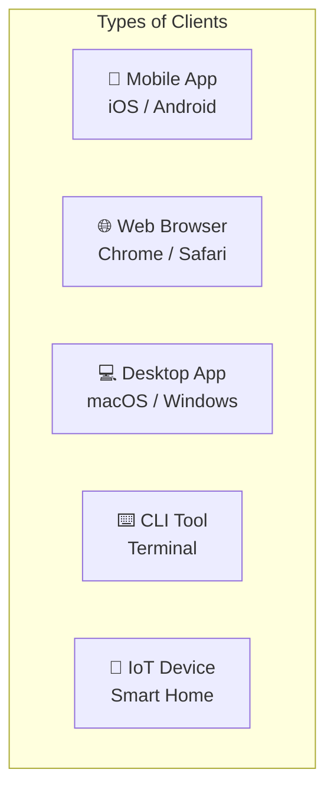
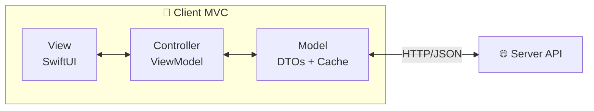

# Client

> The user-facing component of a software system that runs on the user's device.

## Definition

A **client** is the part of a distributed system that:
- Runs on the **user's device** (phone, computer, browser)
- **Initiates** communication with servers
- Presents the **user interface**
- Processes responses for **display**

## Types of Clients



### Native Mobile Client
- iOS apps (Swift/SwiftUI)
- Android apps (Kotlin/Compose)
- Full device access (camera, GPS, sensors)
- App Store distribution

### Web Browser Client
- Runs JavaScript in browser
- Limited device access
- No installation required
- Cross-platform by default

### Desktop Client
- macOS, Windows, Linux apps
- Full system access
- Installed locally
- Electron, SwiftUI, .NET

## Client Responsibilities

| Responsibility | Description |
|----------------|-------------|
| **UI Rendering** | Display data visually |
| **User Input** | Capture taps, clicks, keyboard |
| **Local State** | Manage UI and cached data |
| **API Calls** | Request data from server |
| **Offline Support** | Cache and queue operations |

## Client in MVC

In a client-server architecture, the client contains its own MVC:



## Thin vs. Thick Clients

| Thin Client | Thick Client |
|-------------|--------------|
| Minimal local logic | Substantial local logic |
| Server does processing | Client does processing |
| Always needs network | Can work offline |
| Web apps (SSR) | Native mobile apps |

## iOS Example

```swift
// Client-side components
struct ProductListView: View {          // CLIENT: View
    @State var viewModel: ProductViewModel  // CLIENT: Controller
    
    var body: some View {
        List(viewModel.products) { product in
            ProductRow(product: product)
        }
        .task {
            await viewModel.fetchProducts()  // Calls SERVER
        }
    }
}

@Observable
class ProductViewModel {                 // CLIENT: Controller
    var products: [Product] = []         // CLIENT: Model (cached)
    private let apiClient: APIClient
    
    func fetchProducts() async {
        products = try await apiClient.get("/products")  // → SERVER
    }
}
```

## Related Concepts
- [[Server]] - The counterpart to client
- [[Client-Server-Architecture]] - The overall pattern
- [[Network-Layer-Design]] - How clients communicate
- [[Offline-First-Architecture]] - Client independence

## Tags
#system-architecture #client #distributed #networking
