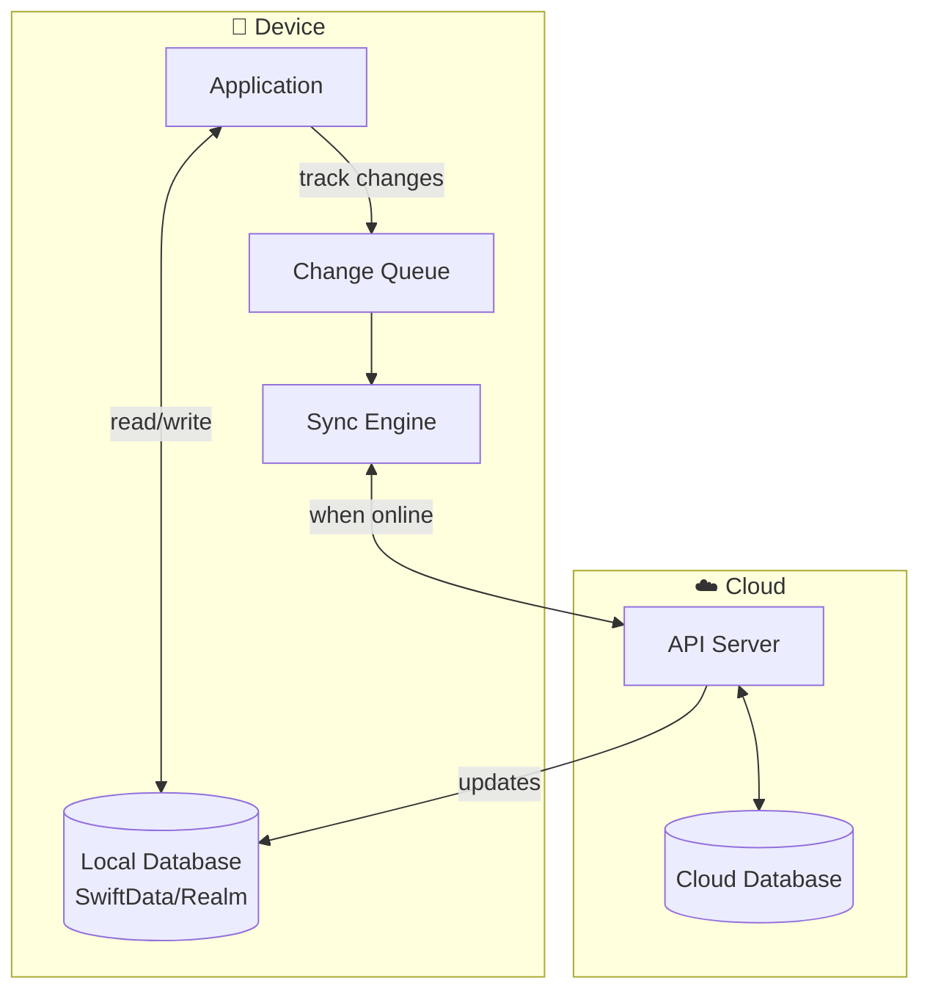
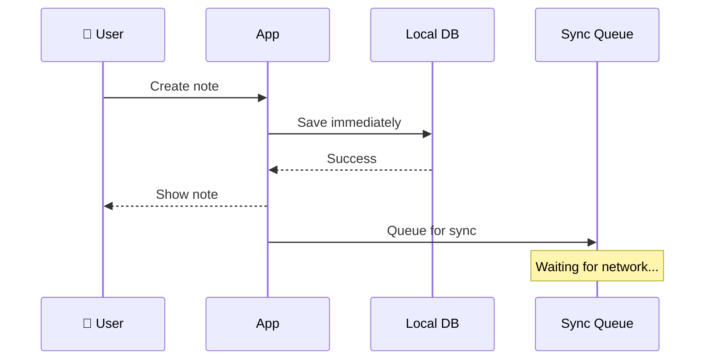
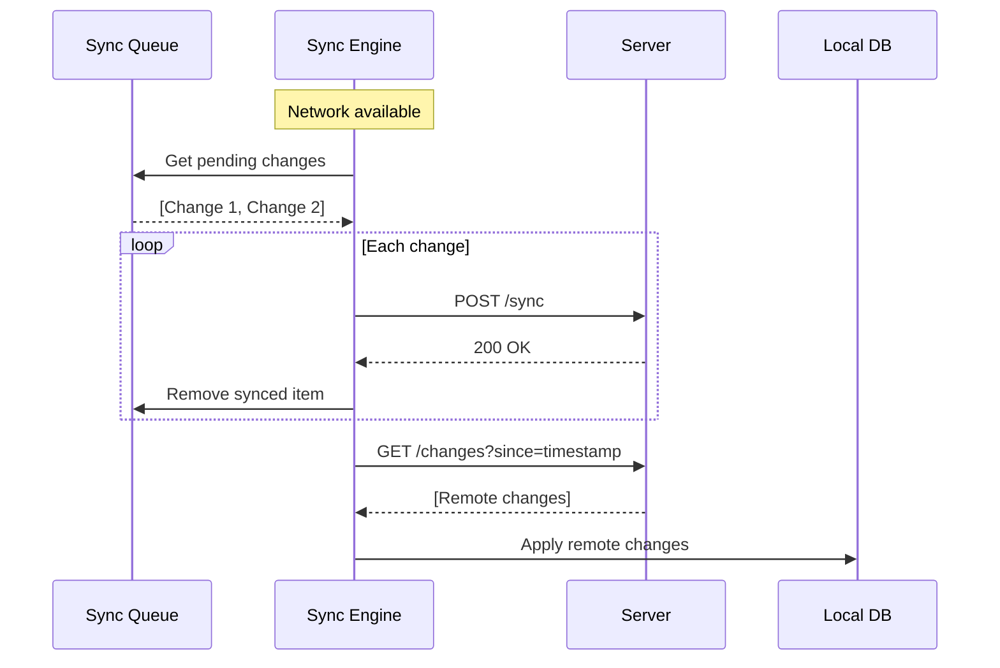

# Offline-First Architecture

> Designing applications that work without network connectivity and sync when online.

## Definition

**Offline-First** is an architecture approach where:
- The app is **fully functional offline**
- Data is stored **locally first**
- Changes are **synced** when connectivity returns
- Network is treated as an **enhancement**, not a requirement

## Why Offline-First?

| Scenario | Reality |
|----------|---------|
| Subway commute | No signal |
| Rural areas | Poor connectivity |
| Airplane mode | No network |
| Flaky WiFi | Intermittent connection |
| Network congestion | Slow responses |

Users expect apps to work regardless of connectivity.

## Architecture Overview



## Data Flow Patterns

### Write Path (Offline)



### Sync Path (Online)



## Implementation Strategies

### 1. Local-First with Sync Queue

```swift
@Observable
class NoteService {
    private let localStorage: LocalNoteStorage
    private let syncQueue: SyncQueue
    private let apiClient: APIClient
    
    func createNote(_ note: Note) async {
        // 1. Save locally FIRST (instant)
        await localStorage.save(note)
        
        // 2. Queue for sync (background)
        await syncQueue.enqueue(.create(note))
        
        // 3. Try sync if online
        if NetworkMonitor.shared.isConnected {
            await syncPendingChanges()
        }
    }
    
    func syncPendingChanges() async {
        let pending = await syncQueue.getPending()
        
        for change in pending {
            do {
                try await apiClient.sync(change)
                await syncQueue.markComplete(change)
            } catch {
                // Will retry later
                break
            }
        }
    }
}
```

### 2. CRDT-Based Sync (Conflict-Free)

```swift
// Conflict-Free Replicated Data Type
struct TodoItem: CRDT {
    let id: UUID
    var title: LWWRegister<String>  // Last-Writer-Wins
    var isComplete: LWWRegister<Bool>
    var tags: ORSet<String>  // Observed-Remove Set
    
    mutating func merge(with other: TodoItem) {
        title.merge(with: other.title)
        isComplete.merge(with: other.isComplete)
        tags.merge(with: other.tags)
    }
}
```

### 3. Event Sourcing

```swift
// Store events, derive state
enum NoteEvent: Codable {
    case created(id: UUID, title: String, timestamp: Date)
    case updated(id: UUID, title: String, timestamp: Date)
    case deleted(id: UUID, timestamp: Date)
}

class EventStore {
    func append(_ event: NoteEvent) async {
        // 1. Save event locally
        await localStorage.append(event)
        // 2. Queue for sync
        await syncQueue.enqueue(event)
    }
    
    func deriveCurrentState() -> [Note] {
        // Replay all events to get current state
        events.reduce(into: [:]) { state, event in
            switch event {
            case .created(let id, let title, _):
                state[id] = Note(id: id, title: title)
            case .updated(let id, let title, _):
                state[id]?.title = title
            case .deleted(let id, _):
                state[id] = nil
            }
        }
        .values.map { $0 }
    }
}
```

## Conflict Resolution

What happens when the same data is modified offline by multiple devices?

```mermaid
flowchart TB
    subgraph Conflict["⚠️ Conflict Scenario"]
        Original[Original: "Hello"]
        Device1[Device 1: "Hello World"]
        Device2[Device 2: "Hello There"]
    end
    
    subgraph Strategies["Resolution Strategies"]
        LWW[Last-Writer-Wins<br/>Based on timestamp]
        Merge[Automatic Merge<br/>CRDTs]
        Manual[Manual Resolution<br/>User decides]
    end
    
    Original --> Device1
    Original --> Device2
    Device1 --> Strategies
    Device2 --> Strategies
```

| Strategy | Pros | Cons |
|----------|------|------|
| **Last-Writer-Wins** | Simple | Data loss possible |
| **CRDT Merge** | No conflicts | Complex data types |
| **Manual Resolution** | User control | Interrupts UX |
| **Operational Transform** | Real-time collab | Very complex |

## SwiftData Offline Example

```swift
@Model
final class Task {
    var title: String
    var isComplete: Bool
    var lastModified: Date
    var syncStatus: SyncStatus
    
    enum SyncStatus: String, Codable {
        case synced
        case pendingUpload
        case pendingDelete
    }
}

@Observable
class TaskRepository {
    private let modelContext: ModelContext
    
    func createTask(title: String) {
        let task = Task(
            title: title,
            isComplete: false,
            lastModified: .now,
            syncStatus: .pendingUpload
        )
        modelContext.insert(task)
        try? modelContext.save()
        
        NotificationCenter.default.post(name: .syncNeeded, object: nil)
    }
    
    func getPendingSync() -> [Task] {
        let descriptor = FetchDescriptor<Task>(
            predicate: #Predicate { $0.syncStatus != .synced }
        )
        return (try? modelContext.fetch(descriptor)) ?? []
    }
}
```

## Key Components

| Component | Responsibility |
|-----------|----------------|
| **Local Database** | Primary data store (SwiftData, Realm) |
| **Sync Queue** | Track pending changes |
| **Sync Engine** | Coordinate upload/download |
| **Conflict Resolver** | Handle concurrent edits |
| **Network Monitor** | Detect connectivity |

## Related Concepts
- [[Client-Server-Architecture]] - The underlying model
- [[SwiftData-Architecture]] - Local persistence
- [[Repository-Pattern]] - Data abstraction
- [[Client]] - Where offline logic lives

## Tags
#system-architecture #offline #sync #mobile #persistence
