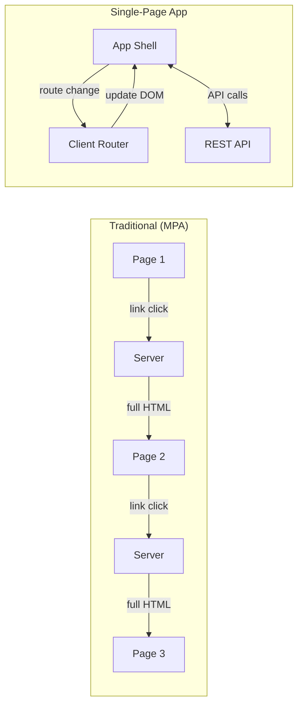
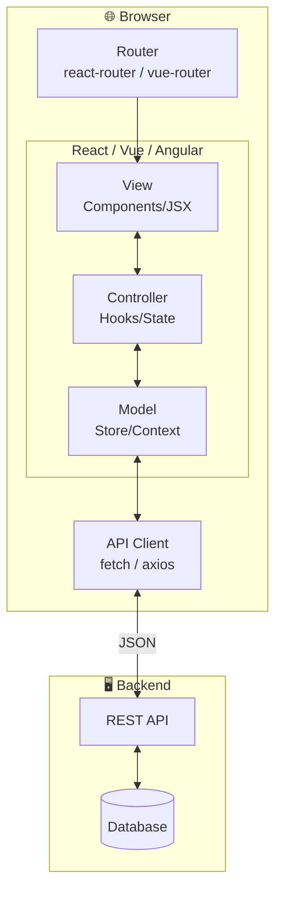

# SPA - Single-Page Application

> A web application that loads once and dynamically updates content without full page reloads.

## Definition

A **Single-Page Application (SPA)** is a web app where:
- A single HTML page loads initially with JavaScript
- All UI updates happen **client-side** via DOM manipulation
- Data is fetched via **API calls** (AJAX/fetch)
- Navigation is handled by **client-side routing**

## How SPAs Work

```mermaid
flowchart TB
    subgraph Initial["1️⃣ Initial Load"]
        Browser1[Browser]
        CDN[CDN / Server]
        Bundle[bundle.js<br/>+ index.html]
    end
    
    Browser1 -->|GET /| CDN
    CDN -->|HTML + JS| Browser1
    Bundle --> Browser1
    
    subgraph Runtime["2️⃣ Runtime"]
        Browser2[Browser]
        SPA[SPA Running<br/>React/Vue/Angular]
        API[API Server]
    end
    
    Browser2 --> SPA
    SPA <-->|fetch() JSON| API
    SPA -->|DOM updates| Browser2
```

## SPA vs Traditional Web



| Aspect | Traditional (MPA) | SPA |
|--------|-------------------|-----|
| Page Load | Full HTML each time | Once, then updates |
| Server Role | Renders HTML | Serves JSON API |
| Navigation | Browser handles | JavaScript handles |
| Initial Load | Fast | Slower (JS bundle) |
| Subsequent | Slower (full page) | Fast (API only) |
| SEO | Native | Requires SSR/prerender |

## SPA Architecture (MVC in Browser)



## Popular SPA Frameworks

| Framework | Language | Key Concepts |
|-----------|----------|--------------|
| **React** | JavaScript/TypeScript | Components, Hooks, JSX |
| **Vue** | JavaScript/TypeScript | Composition API, SFC |
| **Angular** | TypeScript | Services, RxJS, Modules |
| **Svelte** | JavaScript | Compile-time reactivity |

## React SPA Example

```jsx
// App.jsx - SPA Entry Point
import { BrowserRouter, Routes, Route } from 'react-router-dom';

function App() {
  return (
    <BrowserRouter>
      <Routes>
        <Route path="/" element={<Home />} />
        <Route path="/products" element={<ProductList />} />
        <Route path="/products/:id" element={<ProductDetail />} />
      </Routes>
    </BrowserRouter>
  );
}

// ProductList.jsx - Component with API call
function ProductList() {
  const [products, setProducts] = useState([]);
  const [loading, setLoading] = useState(true);
  
  useEffect(() => {
    fetch('/api/products')
      .then(res => res.json())
      .then(data => {
        setProducts(data);
        setLoading(false);
      });
  }, []);
  
  if (loading) return <Spinner />;
  
  return (
    <ul>
      {products.map(p => (
        <li key={p.id}>
          <Link to={`/products/${p.id}`}>{p.name}</Link>
        </li>
      ))}
    </ul>
  );
}
```

## Pros and Cons

| Pros | Cons |
|------|------|
| ✅ Fast after initial load | ❌ Large initial bundle |
| ✅ Rich interactivity | ❌ SEO challenges |
| ✅ Native app-like feel | ❌ JavaScript required |
| ✅ Reduced server load | ❌ Memory management |
| ✅ Offline capable (PWA) | ❌ Complex state management |

## When to Use SPA

✅ **Good for:**
- Dashboards and admin panels
- Interactive applications (Figma, Notion)
- Social media feeds
- Real-time collaboration tools

❌ **Avoid for:**
- Content-heavy sites (blogs, news)
- SEO-critical pages
- Simple CRUD apps
- Low-bandwidth users

## Related Concepts
- [[SSR-Server-Side-Rendering]] - Alternative rendering strategy
- [[Client-Server-Architecture]] - The underlying pattern
- [[Client]] - The browser as client
- [[MVC-Across-Architectures]] - MVC in web context

## Tags
#web #spa #javascript #frontend #architecture
