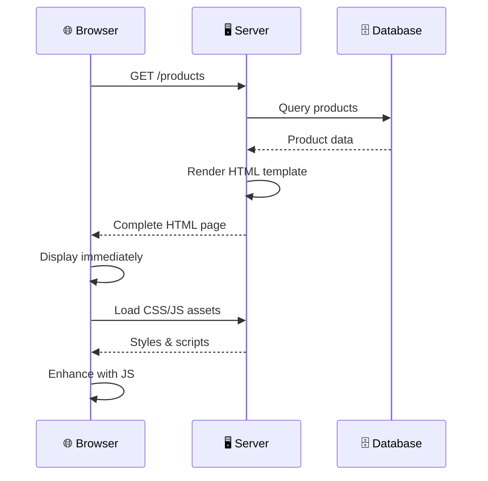
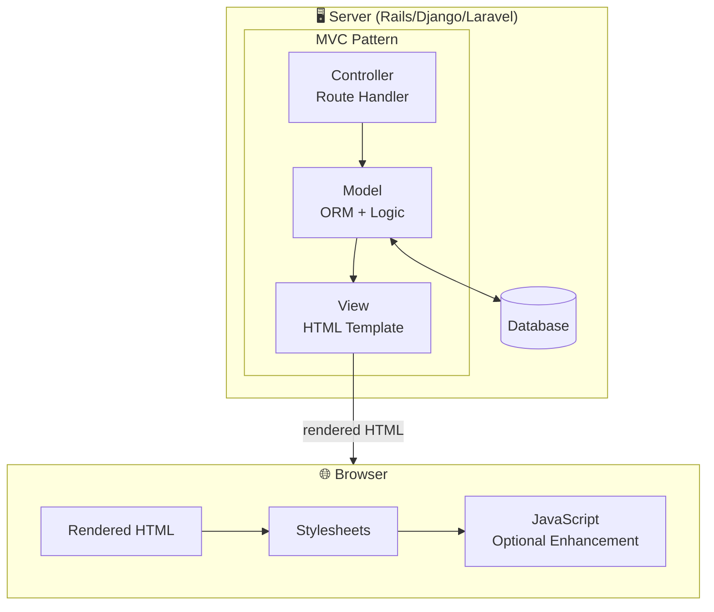
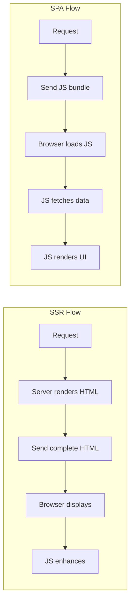
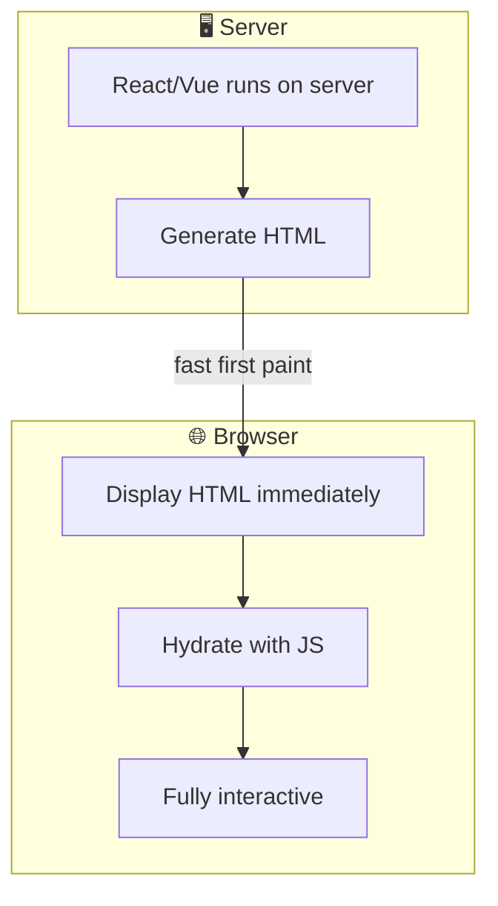

# SSR - Server-Side Rendering

> A rendering strategy where HTML is generated on the server for each request.

## Definition

**Server-Side Rendering (SSR)** is a web architecture where:
- The **server generates HTML** for each page request
- Browser receives **complete, rendered HTML**
- JavaScript may enhance interactivity after load
- Traditional approach used by Rails, Django, Laravel

## How SSR Works



## SSR Architecture



## SSR Frameworks

| Framework | Language | Template Engine |
|-----------|----------|-----------------|
| **Ruby on Rails** | Ruby | ERB |
| **Django** | Python | Jinja2 |
| **Laravel** | PHP | Blade |
| **ASP.NET MVC** | C# | Razor |
| **Next.js** | JavaScript | React (SSR) |
| **Nuxt.js** | JavaScript | Vue (SSR) |

## Rails Example (Classic SSR)

```ruby
# Controller
class ProductsController < ApplicationController
  def index
    @products = Product.where(active: true)
                       .order(created_at: :desc)
                       .limit(20)
  end
  
  def show
    @product = Product.find(params[:id])
  end
end

# View (ERB Template)
# products/index.html.erb
<h1>Products</h1>

<ul class="product-list">
  <% @products.each do |product| %>
    <li>
      <a href="<%= product_path(product) %>">
        <%= product.name %> - $<%= product.price %>
      </a>
    </li>
  <% end %>
</ul>
```

## SSR vs SPA Comparison



| Aspect | SSR | SPA |
|--------|-----|-----|
| First Paint | ⚡ Immediate | 🐢 After JS loads |
| SEO | ✅ Excellent | ⚠️ Requires work |
| Server Load | Higher | Lower |
| Interactivity | Requires JS | Built-in |
| Complexity | Lower | Higher |
| Offline | Limited | PWA possible |

## Modern SSR (Hybrid)

Modern frameworks combine SSR with client-side hydration:



### Next.js (React SSR)

```jsx
// pages/products/[id].js
export async function getServerSideProps({ params }) {
  // Runs on SERVER for each request
  const product = await fetchProduct(params.id);
  
  return {
    props: { product }  // Passed to component
  };
}

export default function ProductPage({ product }) {
  // Rendered on server, hydrated on client
  return (
    <div>
      <h1>{product.name}</h1>
      <p>${product.price}</p>
      <AddToCartButton product={product} />
    </div>
  );
}
```

## Pros and Cons

| Pros | Cons |
|------|------|
| ✅ Fast first paint | ❌ Server per request |
| ✅ SEO-friendly | ❌ TTFB (time to first byte) |
| ✅ Works without JS | ❌ Full page reloads |
| ✅ Simpler mental model | ❌ Less interactive |
| ✅ Better for content sites | ❌ Higher server costs |

## When to Use SSR

✅ **Good for:**
- Content sites (blogs, news, docs)
- E-commerce product pages
- SEO-critical pages
- Low-JavaScript environments

❌ **Consider SPA for:**
- Highly interactive apps
- Real-time features
- Admin dashboards

## Related Concepts
- [[SPA-Single-Page-Application]] - Alternative approach
- [[Client-Server-Architecture]] - The underlying pattern
- [[Server]] - Where rendering happens
- [[MVC-Across-Architectures]] - MVC in web context

## Tags
#web #ssr #rendering #backend #seo
