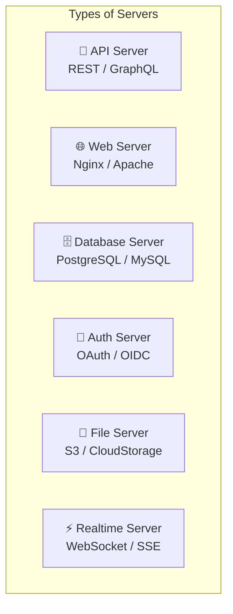
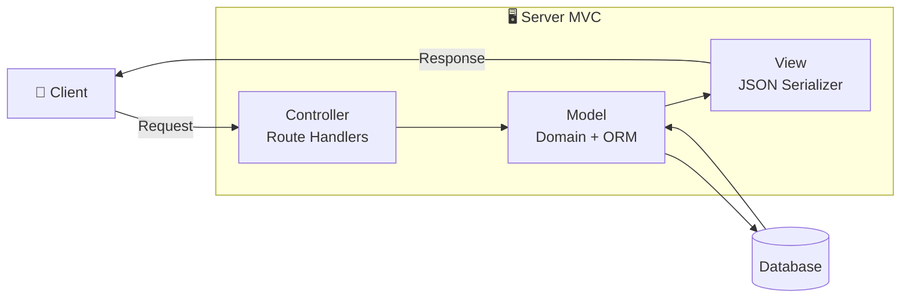
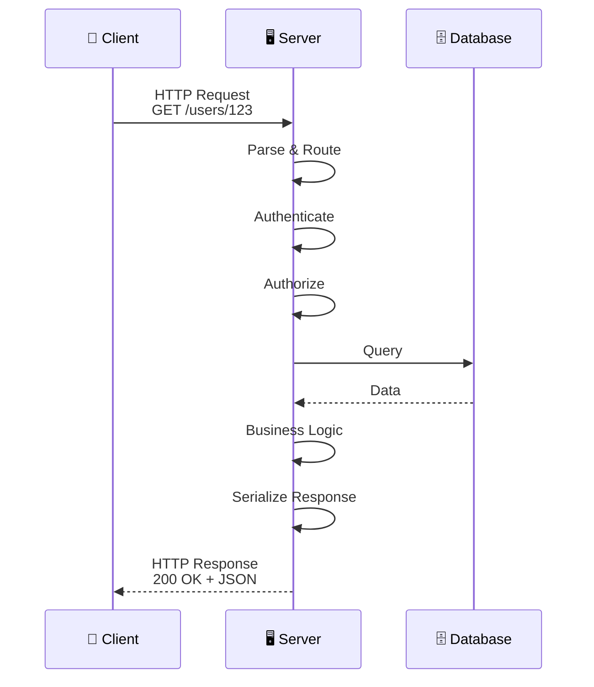

# Server

> A system component that receives requests, processes them, and returns responses.

## Definition

A **server** is the part of a distributed system that:
- Runs on **remote infrastructure** (data center, cloud)
- **Waits for** and responds to client requests
- Manages **shared data** across users/devices
- Handles **business logic**, authentication, and integrations

## Types of Servers



### API Server
- Exposes endpoints for client operations
- Returns JSON/XML data
- Stateless request handling
- REST, GraphQL, gRPC protocols

### Database Server
- Stores persistent data
- Handles queries and transactions
- Ensures data integrity
- PostgreSQL, MySQL, MongoDB

### Authentication Server
- Manages user identity
- Issues tokens (JWT, OAuth)
- Handles login flows
- Firebase Auth, Auth0, Keycloak

## Server Responsibilities

| Responsibility | Description |
|----------------|-------------|
| **Request Handling** | Parse and route incoming requests |
| **Business Logic** | Execute domain rules |
| **Data Persistence** | Store and retrieve data |
| **Authentication** | Verify user identity |
| **Authorization** | Check permissions |
| **Integration** | Connect to external services |

## Server in MVC

Servers often implement their own MVC pattern:



## Server Technologies

### By Language
| Language | Frameworks |
|----------|------------|
| Swift | Vapor, Hummingbird |
| Node.js | Express, Fastify, NestJS |
| Python | Django, FastAPI, Flask |
| Ruby | Rails, Sinatra |
| Go | Gin, Echo, Fiber |
| Java | Spring Boot |

### By Architecture
| Pattern | Description |
|---------|-------------|
| **Monolith** | Single deployable unit |
| **Microservices** | Multiple small services |
| **Serverless** | Functions as a Service (Lambda) |
| **BFF** | Backend for Frontend |

## Request-Response Cycle



## Server Example (Vapor/Swift)

```swift
// Server-side Swift with Vapor

// MODEL
final class User: Model, Content {
    @ID var id: UUID?
    @Field var name: String
    @Field var email: String
}

// CONTROLLER
struct UserController: RouteCollection {
    func boot(routes: RoutesBuilder) throws {
        routes.get("users", ":id", use: getUser)
        routes.post("users", use: createUser)
    }
    
    func getUser(req: Request) async throws -> User {
        guard let user = try await User.find(req.parameters.get("id"), on: req.db) else {
            throw Abort(.notFound)
        }
        return user  // VIEW: Auto-serialized to JSON
    }
}
```

## Related Concepts
- [[Client]] - The counterpart to server
- [[Client-Server-Architecture]] - The overall pattern
- [[Network-Layer-Design]] - Client-server communication
- [[BFF-Pattern]] - Specialized server for clients

## Tags
#system-architecture #server #backend #api #distributed
